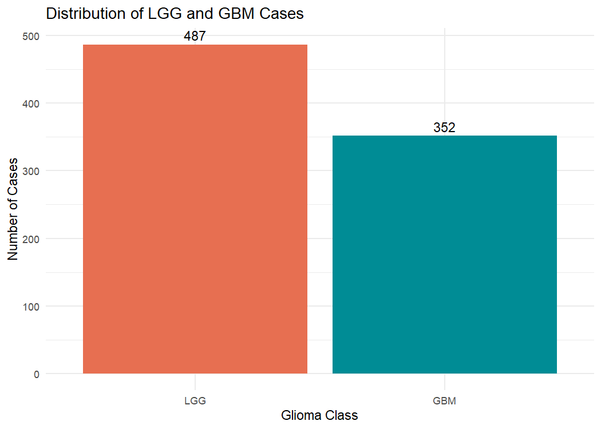
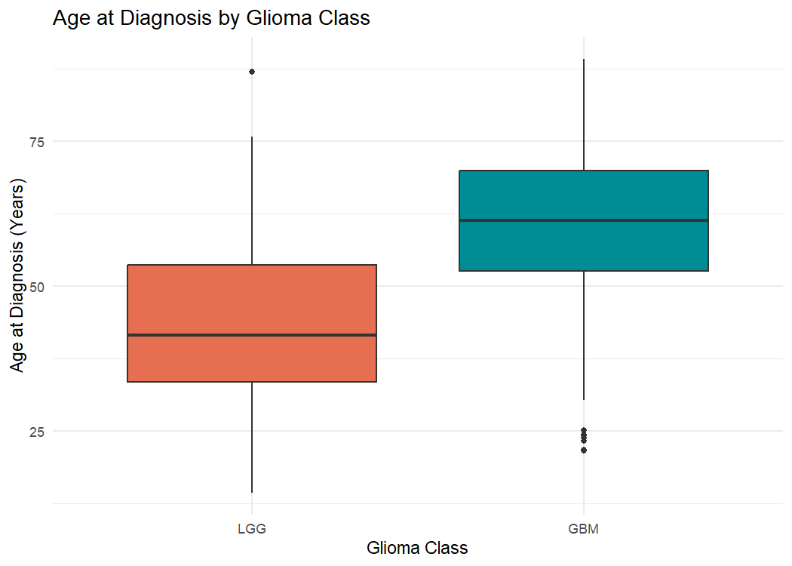
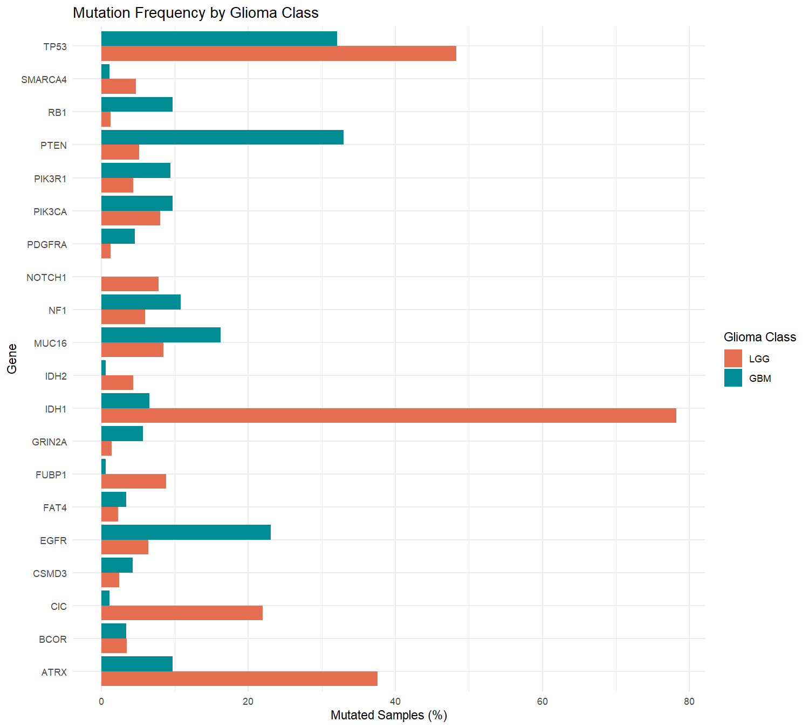
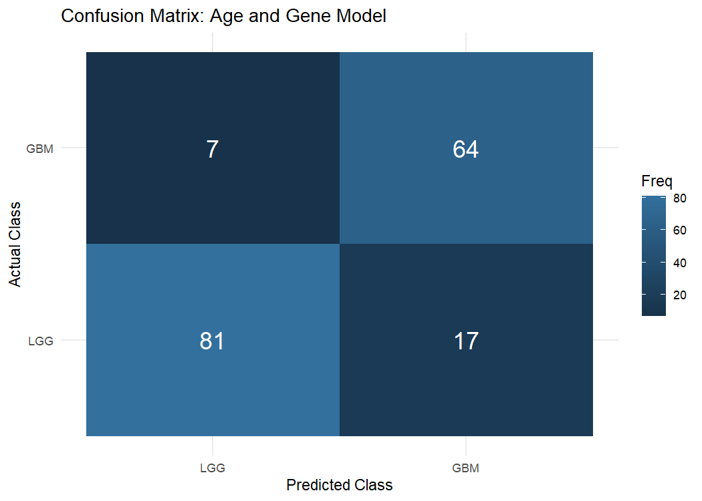

# Brain Glioma Grading Using Clinical and Genetic Mutation Features in R

**ICA 3 – Bioinformatics Project**

**Student Registration Number:** 2021ICT106 
**Programming Language:** R  
**Development Environment:** RStudio  
**Dataset:** Glioma Grading Clinical and Mutation Features  
**Data Source:** UCI Machine Learning Repository / The Cancer Genome Atlas (TCGA)

---

## Abstract

This project checks whether age and five gene mutations can help tell lower-grade glioma (LGG) and glioblastoma (GBM) apart. I used 839 records from the UCI glioma dataset and ran the analysis in R. I looked at age and mutation patterns, used Fisher's exact test to compare IDH1 mutation status across the two groups, and fitted two logistic regression models. On the same 169 test cases, accuracy rose from 72.78% with age alone to 85.80% with age and five genes. The second model found 64 of the 71 GBM cases, compared with 48 for the age-only model. These results apply to the recorded labels in this dataset and would need to be tested on a separate group of patients.

---

## 1. Introduction

### 1.1 Background

Gliomas are tumours that start in the brain or spinal cord. The dataset groups them as lower-grade glioma (LGG) or glioblastoma (GBM). GBM is generally more aggressive. This project uses the two labels recorded in the dataset.

Age at diagnosis is easy to measure, but people in both groups can be diagnosed at similar ages. Gene mutations can give more information about the tumour. For example, IDH1 is involved in cell metabolism, and ATRX helps regulate how DNA is packaged. The UCI dataset includes mutation indicators for these genes and others. That makes it possible to test whether a small set of genes improves a model that already uses age. The study that introduced the dataset also looked at how clinical and mutation data could help classify gliomas (Tasci et al., 2022).

### 1.3 Research Question

**Can clinical and genetic mutation features distinguish LGG from GBM, and does adding selected gene-mutation indicators improve classification performance compared with age alone?**

### 1.4 Research Objectives

1. Obtain and examine a real-world glioma dataset.
2. Perform data quality checks and preprocessing in R.
3. Explore age distributions and genetic mutation frequencies.
4. Investigate the association between IDH1 mutation status and glioma class.
5. Develop logistic regression classification models.
6. Compare model performance using accuracy, precision, recall, specificity and F1-score.
7. Interpret the biological significance, limitations and potential implications of the findings.

### 1.5 Research Hypothesis

**H1:** Including selected genetic mutation indicators alongside age at diagnosis improves the classification of LGG and GBM compared with using age alone.

---

## 2. Dataset Description

### 2.1 Data Source

The dataset was obtained from the **UCI Machine Learning Repository**.

Dataset name: *Glioma Grading Clinical and Mutation Features*

Dataset URL: https://archive.ics.uci.edu/dataset/759/glioma-grading-clinical-and-mutation-features-dataset

The dataset was developed using information from The Cancer Genome Atlas (TCGA), specifically the TCGA-LGG and TCGA-GBM projects.

The preprocessed file `TCGA_InfoWithGrade.csv` was used for this analysis.

### 2.2 Dataset Characteristics

| Characteristic | Description |
|---|---|
| Total records | 839 |
| Input features | 23 |
| Clinical/demographic features | 3 |
| Genetic mutation features | 20 |
| Target variable | Grade |
| Classification type | Binary classification |
| LGG cases | 487 |
| GBM cases | 352 |
| Data format | CSV |

The target variable `Grade` contains two categories:

- **0 – LGG:** Lower-Grade Glioma
- **1 – GBM:** Glioblastoma Multiforme

The three clinical/demographic variables are `Gender`, `Age_at_diagnosis` and `Race`.

The 20 genetic features include IDH1, TP53, ATRX, PTEN, EGFR, CIC, MUC16, PIK3CA, NF1, PIK3R1, FUBP1, RB1, NOTCH1, BCOR, CSMD3, SMARCA4, GRIN2A, IDH2, FAT4 and PDGFRA.

Each genetic feature is represented using binary values:

- **0:** Mutation not recorded
- **1:** Mutation recorded

These variables describe mutation status rather than gene-expression levels.

### 2.3 Data Quality and Ethical Considerations

The original UCI collection had 862 records. The dataset creators removed 23 records with missing or unreported clinical information. The prepared CSV has 839 records and no missing values. It leaves out case IDs, though it still contains demographic and mutation information. This report uses group summaries.

The dataset is available under the Creative Commons Attribution 4.0 International licence (CC BY 4.0). The dataset citation and the paper that describes it are listed in the references.

---

## 3. Methodology

### 3.1 Programming Environment

The project was implemented using R and RStudio.

The following packages and functions were used:

| Package / Function | Purpose |
|---|---|
| `ggplot2` | Statistical visualisation |
| `rmarkdown` | Reproducible HTML reporting |
| `knitr` | Executing and presenting R Markdown results |
| `here` | Managing project-relative file paths |
| `read.csv()` | Importing the dataset |
| `glm()` | Logistic regression |
| `fisher.test()` | Statistical association testing |
| `table()` | Class-frequency and confusion-matrix calculations |

The analysis was documented in an R Markdown file to combine source code, explanations, tables and visualisations.

### 3.2 Data Import and Preprocessing

I loaded the CSV with `read.csv()` and checked its size and column names. I checked for missing values and identical rows. I also confirmed that the grade and all 20 mutation columns use only 0 and 1. The notebook adds an LGG or GBM label for plots and keeps the original numeric grade for the models.

Two rows had the same values in every column. The prepared CSV has no case IDs, so I kept both rows. They both went into the training set for the split used here.

### 3.3 Exploring the data

I made three plots to describe the dataset. The first shows how many cases are in each group. The second compares age at diagnosis. The third shows the percentage of cases with a mutation for each of the 20 genes. I calculated each percentage within its own group, since there are more LGG than GBM cases.

### 3.4 Statistical Analysis

Fisher's exact test was used to investigate the relationship between IDH1 mutation status and glioma class.

The hypotheses were:

**H0:** IDH1 mutation status and glioma class are independent.

**H1:** IDH1 mutation status and glioma class are associated.

A significance level of 0.05 was used when interpreting the statistical test.

### 3.5 Model Development

I used two logistic regression models to see what changes when gene information is added to age.

**Model A – Age-Only Model**

This baseline model used `Age_at_diagnosis` as the only predictor.

**Model B – Age and Genetic Mutation Model**

This model used age at diagnosis and five selected mutation indicators:

- IDH1
- TP53
- ATRX
- EGFR
- PTEN

The model uses IDH1, TP53 and ATRX, which were more often mutated in LGG, and EGFR and PTEN, which were more often mutated in GBM. This gives the model a small set of genes with patterns in both groups. The project did not compare all possible sets of genes.

I randomly chose about 80% of the cases from each grade for training and kept the rest for testing. Taking cases from each grade separately kept the class proportions similar in the two sets.

- Training records: 670
- Testing records: 169

The random seed was set to 123 for reproducibility.

Both models were trained on the same training data and evaluated on the same held-out test data.

The model predicted GBM when its estimated GBM probability was 0.5 or higher. Below 0.5 it predicted LGG.

### 3.6 Model Evaluation

Model performance was evaluated using:

- **Accuracy:** Proportion of all correctly classified records.
- **Precision:** Proportion of predicted GBM cases that were actually GBM.
- **Recall:** Proportion of actual GBM cases correctly identified.
- **Specificity:** Proportion of actual LGG cases correctly identified.
- **F1-score:** Harmonic mean of precision and recall.

GBM was treated as the positive class.

A confusion matrix was used to examine true positives, true negatives, false positives and false negatives.

---

## 4. Results

### 4.1 Distribution of Glioma Classes

**Figure 1: Distribution of LGG and GBM cases in the dataset.**

The dataset contained 487 LGG records (58.05%) and 352 GBM records (41.95%).

LGG was the majority class. This represents moderate class imbalance, highlighting the importance of using evaluation metrics beyond accuracy.

### 4.2 Age at Diagnosis

**Figure 2: Comparison of age at diagnosis between LGG and GBM cases.**

The boxplot shows that GBM patients generally had a higher age at diagnosis than LGG patients.

The median age was 41.6 years for LGG and 61.4 years for GBM.

However, the distributions overlapped. This suggests that age provides useful information but cannot independently distinguish every LGG and GBM case.

### 4.3 Genetic Mutation Frequency

**Figure 3: Mutation frequencies of 20 genes across LGG and GBM cases.**

Different genes displayed different mutation patterns between the two groups.

IDH1, ATRX, TP53 and CIC mutations were more frequently observed among LGG records, while EGFR and PTEN mutations were more frequent among GBM records.

IDH1 had the largest difference, with mutations in 78.23% of LGG cases and 6.53% of GBM cases.

### 4.4 Fisher's Exact Test Results

Fisher's exact test was conducted to evaluate the association between IDH1 mutation status and glioma class.

| Statistical measure | Result |
|---|---|
| P-value | 4.348595 × 10⁻¹⁰⁶ |
| Estimated odds ratio | 0.01959 |
| 95% confidence interval | 0.01164–0.03175 |
| Significance level | 0.05 |

The p-value was substantially below 0.05. Therefore, the null hypothesis of independence was rejected.

The estimated odds ratio indicated considerably lower odds of an IDH1 mutation in GBM compared with LGG.

This provides strong statistical evidence of an association between IDH1 mutation status and glioma class within the analysed dataset.

However, statistical association does not establish a causal relationship.

### 4.5 Machine Learning Model Comparison

The results of both logistic regression models were compared using the 169 test records.

| Evaluation Metric | Age Only | Age + 5 Genes |
|---|---:|---:|
| Accuracy | 72.78% | **85.80%** |
| Precision | 67.61% | **79.01%** |
| Recall | 67.61% | **90.14%** |
| Specificity | 76.53% | **82.65%** |
| F1-score | 67.61% | **84.21%** |

The age-only model achieved 72.78% accuracy, whereas the model incorporating age and five mutation indicators achieved 85.80%.

This represents an improvement of **13.02 percentage points** in classification accuracy.

The largest improvement was in GBM recall, which increased by 22.53 percentage points, from 67.61% to 90.14%.

The F1-score also improved from 67.61% to 84.21%.

The findings indicate that adding the selected genetic mutation features improved predictive performance on the held-out test set.

### 4.6 Confusion Matrix Analysis

**Figure 4: Confusion matrix for the age and five-gene logistic regression model.**

The test dataset contained 169 observations: 98 LGG and 71 GBM cases.

| Actual / Predicted | LGG | GBM |
|---|---:|---:|
| LGG | 81 | 17 |
| GBM | 7 | 64 |

The age-plus-gene model produced:

- **True positives:** 64
- **True negatives:** 81
- **False positives:** 17
- **False negatives:** 7

Overall, the model correctly classified 145 of 169 test cases.

The age-only model had 23 false negatives, while the age-plus-gene model reduced this number to 7.

This reduction is important because a false negative represents a GBM case incorrectly classified as LGG.

The genetic model therefore demonstrated improved identification of GBM cases in this experiment, although classification errors remained.

---

## 5. Discussion

### 5.1 What the results show

The two grades differ in both age and mutation patterns. The GBM group had a higher median age, but the age ranges overlap. IDH1 shows a much larger contrast in mutation rates between the groups. PTEN and EGFR show the opposite pattern to IDH1, with mutations more common among GBM cases. Fisher's exact test supports a link between IDH1 status and the recorded grade.

The age-only model got 123 of the 169 test cases right. Adding the five genes raised that to 145. The combined model made fewer errors in both groups. It missed 7 GBM cases instead of 23 and wrongly called 17 LGG cases GBM instead of 23. These counts show where the gain in accuracy came from. Since all five genes were added together, this comparison does not show how much each one helped on its own.

### 5.2 Limits of the study

The data come from two historical TCGA projects. The mix of cases could be different in another hospital or in a more recent dataset. The current study also uses a single split, so its scores could change if different cases were held out. A test on data collected separately would give a better idea of how well the models work elsewhere.

The model predicts the two labels in the UCI file. Current glioma diagnosis uses more detailed information about the tumour than the variables in this model. The results describe this dataset and should be read in that context.

---

## 6. Conclusion and Future Work

Age and five gene mutation indicators classified the recorded glioma grades better than age alone on this test split. The main improvement was in finding GBM cases. A next step would be to test an age-plus-IDH1 model alongside the five-gene model to see how much the other four genes add. Repeating the comparison on other splits and then checking it on a separate dataset would show how stable the results are.

---

## 7. Reproducibility

### 7.1 Software Requirements

The analysis was developed using the following software environment:

| Software / Package | Version |
|---|---|
| R | 4.6.2 |
| Operating System | Windows 11 x64 |
| ggplot2 | 4.0.3 |
| rmarkdown | 2.32 |
| knitr | 1.52 |
| here | 1.0.2 |

The complete R session information is included in the rendered analysis document.

### 7.2 Project Structure

The repository contains the following components:

| Folder / File | Description |
|---|---|
| `README.md` | Complete research report |
| `data/TCGA_InfoWithGrade.csv` | Original preprocessed UCI dataset |
| `data/cleaned_glioma.csv` | Validated analysis dataset |
| `code/analysis.Rmd` | Reproducible R Markdown source |
| `code/analysis.html` | Rendered analysis output |
| `figures/` | Generated visualisations |
| `results/` | Mutation frequencies, model metrics and confusion matrix |

### 7.3 Instructions to Reproduce

1. Download or clone this GitHub repository.
2. Install R and RStudio.
3. Install the required packages using the R Console:

   `install.packages(c("ggplot2", "rmarkdown", "knitr", "here"))`

4. Open the `.Rproj` project file in RStudio.
5. Confirm that `TCGA_InfoWithGrade.csv` is present in the `data/` folder.
6. Open `code/analysis.Rmd`.
7. Click **Knit → Knit to HTML**.
8. Examine the generated HTML report, figures and evaluation tables.

A fixed random seed of 123 is used for the stratified train-test split to support reproducibility.

---

## 8. References

1. Tasci, E., Camphausen, K., Krauze, A., & Zhuge, Y. (2022). *Glioma Grading Clinical and Mutation Features* [Dataset]. UCI Machine Learning Repository. https://doi.org/10.24432/C5R62J

2. Tasci, E., Zhuge, Y., Kaur, H., Camphausen, K., & Krauze, A. V. (2022). Hierarchical Voting-Based Feature Selection and Ensemble Learning Model Scheme for Glioma Grading with Clinical and Molecular Characteristics. *International Journal of Molecular Sciences, 23*(22), 14155. https://doi.org/10.3390/ijms232214155

3. R Core Team. (2026). *R: A language and environment for statistical computing*. R Foundation for Statistical Computing. https://www.r-project.org/

4. Wickham, H. (2016). *ggplot2: Elegant Graphics for Data Analysis*. Springer. https://ggplot2.tidyverse.org/

5. Xie, Y., Allaire, J. J., & Grolemund, G. (2018). *R Markdown: The Definitive Guide*. Chapman and Hall/CRC. https://bookdown.org/yihui/rmarkdown/

6. Xie, Y. (2015). *Dynamic Documents with R and knitr* (2nd ed.). Chapman and Hall/CRC.

7. National Cancer Institute. *The Cancer Genome Atlas Program*. https://www.cancer.gov/ccg/research/genome-sequencing/tcga

---

**End of Report**